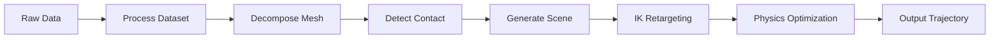

# Workflow: MuJoCo Warp (MJWP)

The MuJoCo Warp (MJWP) workflow is SPIDER's default and most versatile pipeline, supporting both dexterous hand and humanoid robot retargeting with high-performance physics simulation.

## Overview

The MJWP workflow uses MuJoCo with Warp backend for GPU-accelerated physics simulation. It provides the complete pipeline from raw human motion data to physics-based optimized robot trajectories.

**Supported Embodiments:**
- Dexterous hands (Allegro, Inspire, Shadow, Xhand, etc.)
- Humanoid robots (G1, H1, T1, etc.)
- Bimanual configurations


## Workflow Steps



### Step 1: Setup Environment Variables

Define task parameters:

```bash
export TASK=pick_spoon_bowl
export HAND_TYPE=bimanual
export DATA_ID=0
export ROBOT_TYPE=allegro
export DATASET_NAME=oakink
```

### Step 2: Process Dataset

Convert raw human motion data to standardized format:

```bash
uv run spider/process_datasets/oakink.py \
  --task=${TASK} \
  --embodiment-type=${HAND_TYPE} \
  --data-id=${DATA_ID}
```

**What it does:**
- Reads raw motion capture data (MANO poses, object poses)
- Extracts hand kinematics (joint positions, wrist poses)
- Saves processed data in standardized format

**Output:**
```
example_datasets/processed/oakink/mano/bimanual/pick_spoon_bowl/0/
├── trajectory_keypoint.npz
└── info.json
```

::: tip Dataset-Specific Processors
Replace `oakink.py` with the appropriate processor for your dataset:
- `gigahand.py` - GigaHand dataset
- `hot3d.py` - Hot3D dataset
- `fair_fre.py` - FAIR FRE dataset
:::

### Step 3: Decompose Object Mesh

Create convex decomposition for efficient collision detection:

```bash
uv run spider/preprocess/decompose_fast.py \
  --task=${TASK} \
  --dataset-name=${DATASET_NAME} \
  --data-id=${DATA_ID} \
  --embodiment-type=${HAND_TYPE}
```

If you want higher quality convex decomposition, you can use the following command:
```bash
uv run spider/preprocess/decompose.py \
  --task=${TASK} \
  --dataset-name=${DATASET_NAME} \
  --data-id=${DATA_ID} \
  --embodiment-type=${HAND_TYPE}
```

**What it does:**
- Loads object mesh from dataset
- Performs convex decomposition using V-HACD or CoACD
- Saves decomposed mesh components

**Output:**
```
example_datasets/processed/oakink/assets/objects/spoon/convex/
├── 0.obj
├── 1.obj
├── 2.obj
└── visual.obj
```

::: warning
Convex decomposition quality significantly affects simulation accuracy. Complex objects may need manual tuning of decomposition parameters.
:::

### Step 4: Detect Contact (Optional)

Identify hand-object contact points for contact-aware retargeting:

```bash
uv run spider/preprocess/detect_contact.py \
  --task=${TASK} \
  --dataset-name=${DATASET_NAME} \
  --data-id=${DATA_ID} \
  --embodiment-type=${HAND_TYPE}
```

**What it does:**
- Analyzes hand-object proximity throughout trajectory
- Identifies contact points on hand surface
- Saves contact information for trajectory optimization

**Output:**
- Updates `trajectory_keypoint.npz` with contact data

::: tip
Contact detection helps maintain grasp stability during retargeting, especially for manipulation tasks.
:::

### Step 5: Generate Scene

Create MuJoCo scene XML with robot and objects:

```bash
uv run spider/preprocess/generate_xml.py \
  --task=${TASK} \
  --dataset-name=${DATASET_NAME} \
  --data-id=${DATA_ID} \
  --embodiment-type=${HAND_TYPE} \
  --robot-type=${ROBOT_TYPE}
```

**What it does:**
- Loads robot URDF/XML configuration
- Creates scene with objects from dataset
- Sets up collision pairs and contact parameters
- Configures camera and lighting
- Adds the floor as a plane at the floor height of the task. A `table` entry
  in `task_info.json`, which built a box floor in an earlier version of this
  fork, is no longer read and is ignored with no message

**Output:**
```
example_datasets/processed/oakink/allegro/bimanual/pick_spoon_bowl/0/
└── scene.xml
```

**Scene structure:**
```xml
<mujoco>
  <compiler angle="radian" meshdir="assets"/>
  <option timestep="0.01"/>

  <!-- Robot -->
  <worldbody>
    <body name="left_hand">...</body>
    <body name="right_hand">...</body>

    <!-- Objects -->
    <body name="spoon">...</body>
    <body name="bowl">...</body>
  </worldbody>

  <!-- Contact pairs -->
  <contact>
    <pair geom1="left_index_tip" geom2="spoon"/>
    ...
  </contact>
</mujoco>
```

### Step 6: Inverse Kinematics (IK)

A minimum IK scripts based on mink can be used by:

```bash
uv run spider/preprocess/ik_fast.py \
  --task=${TASK} \
  --dataset-name=${DATASET_NAME} \
  --data-id=${DATA_ID} \
  --embodiment-type=${HAND_TYPE} \
  --robot-type=${ROBOT_TYPE}
```

You can also use the original IK script with mujoco by:

```bash
uv run spider/preprocess/ik.py \
  --task=${TASK} \
  --dataset-name=${DATASET_NAME} \
  --data-id=${DATA_ID} \
  --embodiment-type=${HAND_TYPE} \
  --robot-type=${ROBOT_TYPE} \
  --open-hand
```

**What it does:**
- Loads MANO hand poses
- Solves inverse kinematics for robot joints
- Retargets hand poses to robot configuration
- Initializes with open hand pose (`--open-hand`)

**Output:**
```
example_datasets/processed/oakink/allegro/bimanual/pick_spoon_bowl/0/
└── trajectory_kinematic.npz
```

**Data format:**
```python
# trajectory_kinematic.npz contains:
qpos: [T, nq]  # Joint positions
qvel: [T, nv]  # Joint velocities (zero for kinematic)
ctrl: [T, nu]  # Control targets (same as qpos)
time: [T]      # Timestamps
```

::: tip IK Options
- `--open-hand`: Start IK from open hand pose (recommended)
- `--use-contacts`: Use detected contacts in IK optimization
- `--smooth-qvel`: Add velocity smoothness term
:::

#### Side planes for thin bodies

With `--object-clearance`, `ik_fast.py` keeps the hand collision geoms out of
the object with a collision limit. The limit does not choose a side: a
fingertip stays on the side of a thin part, such as a glass plate, that it
reaches first, also when the human finger is on the other side.
`--side-plane-bodies` names the bodies for which each robot fingertip must
stay on the side of the human fingertip:

```bash
uv run spider/preprocess/ik_fast.py \
  --task=${TASK} \
  --dataset-name=${DATASET_NAME} \
  --data-id=${DATA_ID} \
  --embodiment-type=${HAND_TYPE} \
  --robot-type=${ROBOT_TYPE} \
  --object-clearance 0.0 \
  --side-plane-bodies right_object
```

| Item | Behavior |
| --- | --- |
| Default | Off: no body is named |
| Needs | `--object-clearance`. Without it the command stops with a `ValueError` |
| Plane of a frame | For a fingertip whose human fingertip is outside every collision geom of the named bodies and within `SIDE_PLANE_DISTANCE` (0.04 m) of one: the tangent plane of the nearest geom at its nearest point, facing the human fingertip |
| Held side | The planes of every frame are found before IK runs (`SidePlanes.plan`). Over each run of frames in which the human fingertip stays near one body, the side with the most frames holds (`hold_sides`). A frame of the other side, or a frame with the fingertip inside the part, takes the plane of the nearest frame of the held side |
| In IK | One plane geom on a mocap body per fingertip, with a `CollisionAvoidanceLimit` and a `PenetrationTask` between the fingertip geom and its plane |
| Output | The `side_plane_*` arrays of `trajectory_kinematic.npz` ([data structure](../usage/data-structure.md#trajectory-files-npz)) |

The bodies are named and not chosen by thickness. A cup wall is as thin as a
plate, and a human fingertip can read inside the hull of a cup that the hand
holds.

**Frame loop.** The IK loop of the frames after frame 0 follows the presence
of side planes. It has no flag of its own.

| | Without `--side-plane-bodies` | With `--side-plane-bodies` |
| --- | --- | --- |
| IK steps per frame | `max(1, round(ref_dt / sim_dt))` whole steps of `--sim-dt` | Up to `FRAME_STEPS` (40) |
| Bound on a step | None | Each hinge joint within `MAX_HINGE_STEP` (0.29 deg) and each slide joint within `MAX_SLIDE_STEP` (1 mm), through `mink.VelocityLimit` |
| Part of a step that is taken | The whole step | The largest of 1, 1/2, ... `MIN_STEP_SCALE` (1/16) of the step that lowers the task cost at the true kinematics (`improving_scale`). The frame ends when no part does |
| `--sim-dt` sets | The step of every frame, and the timestep of `trajectory_ikrollout.npz` | The step of the two start phases of frame 0, and the timestep of `trajectory_ikrollout.npz` |

The file names, the keys and the shapes of the IK output are the same in both
loops. The log line of the frame loop names the loop that runs.

The bound comes from the collision limit, which is linear in the step. On one
two-hand recording with a 4 mm glass plate at 20 ms frames, a wrist that
turns 5 to 10 deg in one whole step left a fingertip 4.4 to 6.6 mm (95th
percentile) from where the limit row put it, and a turn of 0.1 to 0.5 deg
leaves 0.01 to 0.04 mm. Three wrist hinges at 0.29 deg turn the wrist at most
0.5 deg. Per 20 ms frame the bounds are 11.6 deg and 40 mm, and the fastest
human wrist of that recording moves 8.5 deg and 27.5 mm per frame. A step
that stays in a region in which its linear model is valid, and is taken only
when it lowers the true cost, follows TrajOpt (Schulman et al., RSS 2013,
[DOI 10.15607/RSS.2013.IX.031](https://doi.org/10.15607/RSS.2013.IX.031)).

Measured on that recording and 16 moved copies of it, against a plane per
frame with whole steps: the fingertip passes through the plate fall from 109
to 0, and the frames with a left-hand geom over 1 mm inside the plate fall
from 50 to 0 of 290.

A task without side planes keeps the whole steps. On a pouring task with no
side body, the bounded loop changed the 12 finger joints by about 1 deg (mean
over the carry) with the fingertips within 0.6 mm of their place, and whole
steps put no hand geom more than 0.4 mm into the cup. Without
`--side-plane-bodies` the IK output is bit for bit the output of the code
before the frame loop changed (139 exports of one pouring recording), and
with it the output is bit for bit that of the bounded loop (161 exports of
the plate recording).

::: warning Limits of the side planes and the frame loop
- Naming a side body moves a task to the bounded loop. A frame that ends at
  the bound, or that takes no step, logs nothing.
- A frame can end while a part under 1/16 of the step would still lower the
  cost. On the plate recording, 563 of 1,485 frames take no step.
- A turn of the plane normal of more than 90 deg between two plane frames
  counts as a change of side.
- The constants are sized on one recording at 20 ms frames.
- `ik_fast_test.py` covers the step bound on a hinge and a slide, the part
  of a step that `improving_scale` takes, the hold of a side over a near
  span, and `plan` and `place` on a moving body. No test runs the frame loop
  of `main()`.
:::

### Step 7: Physics-Based Optimization

Optimize trajectory with physics constraints using DIAL-MPC:

```bash
uv run examples/run_mjwp.py \
  +override=${DATASET_NAME} \
  task=${TASK} \
  data_id=${DATA_ID} \
  robot_type=${ROBOT_TYPE} \
  embodiment_type=${HAND_TYPE}
```

**What it does:**
- Loads kinematic trajectory as reference
- Sets up parallel physics simulation (GPU)
- Runs sampling-based optimization (DIAL-MPC)
- Tracks reference while maintaining physics feasibility

**Side reward (`run_mjwp_fast.py`).** When `trajectory_kinematic.npz` holds
side planes (`ik_fast.py --side-plane-bodies`), `examples/run_mjwp_fast.py`
adds a side reward: minus `SIDE_REW_SCALE` (1.0) times the summed distance,
in metres, by which each fingertip collision geom is past its plane. The
plane moves with its simulated body. IK saves a plane that the IK fingertip
is already past at the fingertip, so the reward charges a plan only for
going further past the plane than its IK reference does. `get_reward`
reports the term as `info["side_rew"]`. There is no config switch: a file
with no planes gives no term. `Config.side_plane_geom_ids` is a derived
field that the run sets from the file and saves in its `config.yaml`.
`examples/run_mjwp.py` does not read the side planes, so a task that is
solved through it gets no side reward and no message. `mjwp_test.py` checks
the plane distance on a moving body; no test runs the loading of the planes
or the reward branch.

**Real-time visualization** shows:
- Current robot state
- Reference trajectory (transparent)
- Optimization metrics
- Contact forces

**Output:**
```
example_datasets/processed/oakink/allegro/bimanual/pick_spoon_bowl/0/
├── trajectory_mjwp.npz      # Optimized trajectory
├── visualization_mjwp.mp4   # Rendered video
└── metrics.json             # Success metrics
```

## Augmentation Methods

The original `mjwp_eq` pipeline is no longer supported due to latest mujoco warp release make it unstable.
The newer guidance methods are supported by the `mjwp_act` (e.g. `configs/override/oakink_act.yaml`) configuration instead. You will also need to add the `--act-scene` flag when running the `generate_xml.py` and `ik.py` scripts to ensure the necessary assets and logic are generated properly. This approach will provide the fair comparison you are looking for. Related assets is also available in our huggingface repo.

## Dataset-Specific Examples

### OakInk Dataset

```bash
export TASK=pick_spoon_bowl
export DATASET_NAME=oakink
export DATA_ID=0

# Full workflow
uv run spider/process_datasets/oakink.py --task=${TASK} --embodiment-type=bimanual --data-id=${DATA_ID}
uv run spider/preprocess/decompose_fast.py --task=${TASK} --dataset-name=${DATASET_NAME} --data-id=${DATA_ID} --embodiment-type=bimanual
uv run spider/preprocess/generate_xml.py --task=${TASK} --dataset-name=${DATASET_NAME} --data-id=${DATA_ID} --embodiment-type=bimanual --robot-type=allegro
uv run spider/preprocess/ik.py --task=${TASK} --dataset-name=${DATASET_NAME} --data-id=${DATA_ID} --embodiment-type=bimanual --robot-type=allegro --open-hand
uv run examples/run_mjwp.py +override=oakink task=${TASK} data_id=${DATA_ID} robot_type=allegro embodiment_type=bimanual
```

### GigaHand Dataset

```bash
export TASK=p36-tea
export DATASET_NAME=gigahand
export DATA_ID=10

# Full workflow
uv run spider/process_datasets/gigahand.py --task=${TASK} --embodiment-type=bimanual --data-id=${DATA_ID}
uv run spider/preprocess/decompose_fast.py --task=${TASK} --dataset-name=${DATASET_NAME} --data-id=${DATA_ID} --embodiment-type=bimanual
uv run spider/preprocess/generate_xml.py --task=${TASK} --dataset-name=${DATASET_NAME} --data-id=${DATA_ID} --embodiment-type=bimanual --robot-type=xhand
uv run spider/preprocess/ik.py --task=${TASK} --dataset-name=${DATASET_NAME} --data-id=${DATA_ID} --embodiment-type=bimanual --robot-type=xhand --open-hand
uv run examples/run_mjwp.py +override=gigahand task=${TASK} data_id=${DATA_ID} robot_type=xhand embodiment_type=bimanual
```

### Hot3D Dataset

```bash
export TASK=P0001_4bf4e21a-obj96945373046044
export DATASET_NAME=hot3d
export DATA_ID=0

# Full workflow
uv run spider/process_datasets/hot3d.py --task=${TASK} --embodiment-type=right --data-id=${DATA_ID}
uv run spider/preprocess/decompose_fast.py --task=${TASK} --dataset-name=${DATASET_NAME} --data-id=${DATA_ID} --embodiment-type=right
uv run spider/preprocess/generate_xml.py --task=${TASK} --dataset-name=${DATASET_NAME} --data-id=${DATA_ID} --embodiment-type=right --robot-type=xhand
uv run spider/preprocess/ik.py --task=${TASK} --dataset-name=${DATASET_NAME} --data-id=${DATA_ID} --embodiment-type=right --robot-type=xhand --open-hand
uv run examples/run_mjwp.py +override=hot3d task=${TASK} data_id=${DATA_ID} robot_type=xhand embodiment_type=right
```
